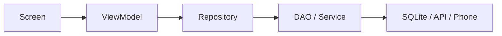
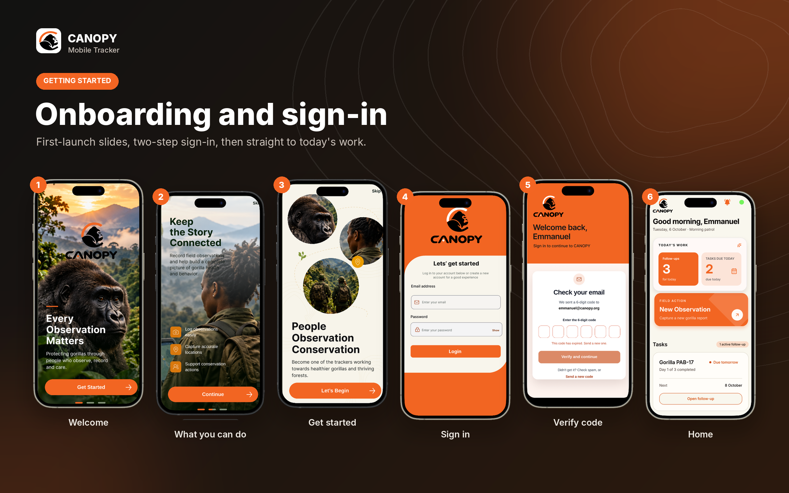
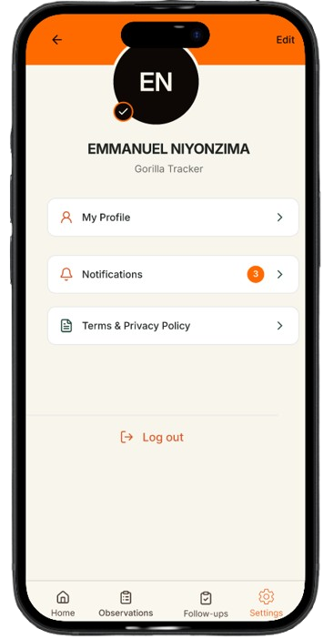
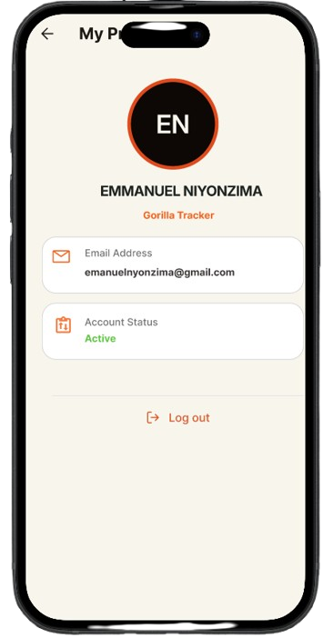
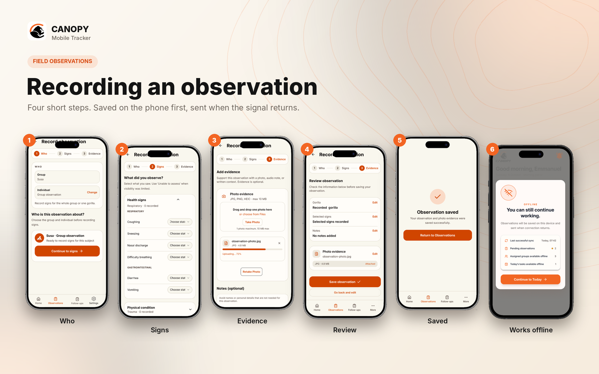
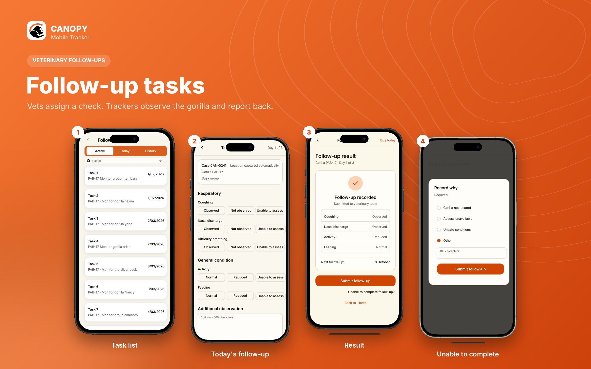

# Frontend Mobile (Flutter): CANOPY Tracker App

## 1. Overview

CANOPY Mobile is the Flutter app that gorilla trackers use in the field to record health observations. The app sends them to the CANOPY backend, where veterinarians review them.

The app is built for Volcanoes National Park: steep terrain, rain, and weak or no mobile signal. It therefore works **offline first**. Every observation is saved in an encrypted database on the phone before anything is sent. When the connection returns, the app sends it automatically.

What a tracker can do in the app:

- Sign in with email and password, then a 6-digit code sent by email. Only accounts with the **tracker** role can use the app.
- Record an observation in four steps:
  1. Choose the group or individual gorilla.
  2. Mark the clinical signs and how severe they are.
  3. Add notes and an optional photo.
  4. Review and save.
- See past observations, with a green **Synced** or red **Unsynced** label on each one.
- See the follow-up tasks a veterinarian has assigned them.
- Get push notifications for new tasks.
- See at a glance whether the phone is online (green dot) or offline (red dot), and how many observations are still waiting to be sent.

The app follows the **MVVM** pattern. Screens only draw what they are given. View models hold the screen logic. Repositories and services talk to the database, the phone and the API.

<p align="center">
  
</p>

## 2. System Architecture

The app is one Flutter codebase for Android and iOS. It uses `provider` for MVVM state, plain `http` for the REST API, and an encrypted SQLite database (SQLCipher) for offline data.

### 2.1 Technology stack

| Area             | Technology                                | Used for                                                             |
| ---------------- | ----------------------------------------- | -------------------------------------------------------------------- |
| Framework        | Flutter, Dart 3                           | Android and iOS app from one codebase                                |
| State management | `provider` with `ChangeNotifier`          | View models that screens listen to                                   |
| Routing          | `MaterialApp` named routes and `AuthGate` | Moving between screens; sending signed-out users to sign-in          |
| Networking       | `http` (JSON and multipart)               | Calls to the CANOPY REST API and photo upload                        |
| Local database   | `sqflite_sqlcipher`                       | Encrypted SQLite database for offline observations and gorilla lists |
| Secure storage   | `flutter_secure_storage`                  | Session token, user profile and the device encryption keys           |
| Photo protection | `cryptography`, `flutter_image_compress`  | Encrypting photos (AES-256-GCM) and removing photo metadata          |
| Connectivity     | `connectivity_plus` and a `/health` check | Online/offline status                                                |
| Location         | `geolocator`                              | GPS position of an observation                                       |
| Media            | `image_picker`                            | Taking or choosing a photo                                           |
| Notifications    | `firebase_messaging`                      | Push notifications from the platform                                 |
| Crash reporting  | `firebase_crashlytics`                    | Crash reports from the field                                         |
| Testing          | `flutter_test`, `sqflite_common_ffi`      | Unit tests with fakes and an in-memory database                      |

### 2.2 Project structure

```
canopy/
├── lib/
│   ├── config/          # Constants, API address, routes, sign catalogue
│   ├── database/        # SQLite database and the DAOs (one per table)
│   ├── models/          # Plain data classes
│   ├── providers/       # View models (MVVM)
│   ├── repositories/    # Observation, reference data and session repositories
│   ├── screens/         # One folder per feature (auth, home, observations, follow_ups, settings, shell)
│   ├── security/        # Device keys, encrypted photo store, HTTPS check
│   ├── services/        # API client, auth, grid, network status, notifications, crash reporting
│   ├── widgets/         # Reusable UI pieces
│   ├── app.dart         # Providers and MaterialApp
│   └── main.dart        # Builds every service once and starts the app
├── assets/icon/         # App icon source (1024 x 1024)
├── android/
├── ios/
└── test/
    ├── fakes/           # Fake services used by the tests
    ├── providers/
    ├── repositories/
    ├── security/
    └── services/
```

### 2.3 Layers

| Layer      | Folder                   | Responsibility                                                   | Example                                                                 |
| ---------- | ------------------------ | ---------------------------------------------------------------- | ----------------------------------------------------------------------- |
| View       | `screens/`, `widgets/`   | Draw state and pass taps to the view model                       | `RecordObservationScreen`                                               |
| View model | `providers/`             | Screen state and rules, exposed through `ChangeNotifier`         | `RecordObservationViewModel`, `SyncViewModel`                           |
| Repository | `repositories/`          | Own the app data and decide where it comes from (API or phone)   | `ObservationRepository`, `ReferenceDataRepository`, `SessionRepository` |
| DAO        | `database/`              | Read and write one database table                                | `SqliteObservationDao`, `SqliteGorillaDao`                              |
| Service    | `services/`, `security/` | One job each: an API endpoint, GPS, connectivity, keys, photos   | `ObservationService`, `FilePhotoStore`                                  |
| Model      | `models/`                | Plain data classes with `fromJson`/`toJson` or `fromRow`/`toRow` | `LocalObservation`, `Gorilla`                                           |

Dependencies only point **downwards**. A screen never calls a service or the database directly, and services know nothing about the UI.



## 3. Core Architectural Components

Each component below has one job. It is created **once** in `main.dart` and then passed to the widget tree through `MultiProvider` in `app.dart`.

### 3.1 Dependency wiring (`main.dart`, `app.dart`)

`main()` builds every service and repository by hand, in order, and passes them to `CanopyApp`. This keeps all the wiring in one place, so tests can swap any part for a fake.

```dart
Future<void> main() async {
  WidgetsFlutterBinding.ensureInitialized();

  TransportSecurity.requireHttps(ApiConfig.baseUrl);

  await Firebase.initializeApp(options: DefaultFirebaseOptions.currentPlatform);
  await CrashReporting.start();

  final keys = DeviceKeyStore();
  final database = await LocalDatabase.open(
    factory: desktop ? databaseFactoryFfi : null,
    password: desktop ? null : await keys.databasePassword(),
  );

  final observationRepository = ObservationRepository(
    dao: SqliteObservationDao(database),
    syncState: SqliteSyncStateDao(database),
    service: observations,
    grids: grids,
    photos: FilePhotoStore(keys: keys),
  );

  runApp(CanopyApp(/* every service and repository */));
}
```

**How it works:**

1. The app refuses to start if the server address is not HTTPS.
2. Firebase and crash reporting start first, so any crash after that is reported.
3. The database key comes from the phone's secure storage, and the database is opened with it.
4. Repositories are built from their DAOs and services.

`CanopyApp` then shares everything with `Provider.value` and creates the two app-wide view models:

```dart
ChangeNotifierProvider<SessionViewModel>(
  create: (_) => SessionViewModel(sessions)..restore(),
),
ChangeNotifierProvider<SyncViewModel>(
  create: (_) => SyncViewModel(
    network: network,
    observations: observationRepository,
    reference: referenceData,
    sessions: sessions,
  )..start(),
),
```

### 3.2 Routing and AuthGate

`MaterialApp` uses a named route table (`Routes.table` in `config/routes.dart`). The start route is `AuthGate`. It picks the first screen based on the session status and whether onboarding has been seen.

Because `AuthGate` watches the session, signing out anywhere in the app returns the user to sign-in, and so does a 401 from the server. No extra navigation code is needed.

The record screen builds its own view model when it opens, so each new observation starts clean:

```dart
recordObservation: (context) {
  final sessions = context.read<SessionRepository>();
  return ChangeNotifierProvider<RecordObservationViewModel>(
    create: (_) => RecordObservationViewModel(
      service: context.read<ObservationService>(),
      tokenProvider: () => sessions.token,
      ownerProvider: () => sessions.current?.user.id,
      network: context.read<NetworkStatus>(),
      observations: context.read<ObservationRepository>(),
      referenceData: context.read<ReferenceDataRepository>(),
      gridService: context.read<GridService>(),
    )..loadIndividuals(),
    child: const RecordObservationScreen(),
  );
},
```

### 3.3 API client (`ApiClient`)

`ApiClient` is one wrapper around `http.Client`. It handles:

- the base URL;
- JSON headers;
- the bearer token;
- a 45-second timeout;
- error messages.

Every failure becomes an `ApiException` with a plain-language message, so view models can show it directly.

The base URL is a compile-time variable, so the same code can point at another server:

```dart
static const baseUrl = String.fromEnvironment(
  'API_URL',
  defaultValue: 'https://canopyy-dfadcbf323a2.herokuapp.com',
);
```

```bash
flutter run --dart-define=API_URL=https://your-backend-url
```

### 3.4 Authentication and session (`AuthService`, `SessionRepository`)

Sign-in has two steps:

1. `POST /auth/login` with email, password and `app: mobile`.
2. `POST /auth/verify-otp` with the 6-digit code, then `GET /users/me` for the profile.

`SessionRepository` keeps the session and saves it in secure storage. It signs the user out when the token expires.

When the app starts, `restore()` reads the saved session. It drops the session if it has expired or the user is not a tracker, and refreshes the profile in the background. A non-tracker account sees `NotTrackerScreen` and is signed out.

### 3.5 Observation submission (`ObservationService`)

- `getIndividuals` pages through `GET /gorillas/`, 100 at a time.
- `sendObservation` sends a multipart `POST /api/v1/observations/batch` with:
  - the grid;
  - the signs as JSON;
  - the notes;
  - the time observed;
  - an optional photo.

It returns the server's observation ID.

`observedAt` is always sent, so an observation saved offline keeps the time it was really made, not the time it was synced.

### 3.6 Location and grid (`LocationService`, `GridService`)

`LocationService` checks that GPS is on and that permission is granted. It then asks `geolocator` for a high-accuracy position, with a 20-second limit.

`GridService` sends that position to `POST /api/v1/locations`, which returns the park grid cell (`grid_id`, `grid_name`).

When the phone is offline, the latitude and longitude are saved with the observation, and the grid is looked up later during sync. Once the grid is found, **the exact GPS position is removed from the phone** (see section 5).

### 3.7 Record observation view model

`RecordObservationViewModel` drives the four steps (who, signs, evidence, review). It:

- checks each step;
- maps each sign to a backend category such as respiratory or gastrointestinal;
- requires a severity for every sign marked present;
- limits notes to 500 characters.

**Every observation is saved on the phone first**, online or offline. Sending is a separate step done by the sync layer (section 4). This means a tracker never loses an observation, even if the send fails halfway.

### 3.8 Observations history and follow-ups

- **Observations tab** (`ObservationsViewModel`): lists the tracker's past observations from the server. Unsent observations from the phone are added at the top with a red **Unsynced** label, and sent ones show a green **Synced** label. The list reloads by itself when a sync finishes.
- **Follow-ups tab** (`FollowUpsViewModel`, `FollowUpApi`): shows the tasks veterinarians have assigned to the tracker.

Both send the session token with every request.

## 4. Advanced Features: Offline Capability

A tracker can record observations with no signal at all. They are saved in an encrypted SQLite database and sent in order when the CANOPY server can be reached again. The gorilla groups and individuals are also stored locally, so the **Who** step works in airplane mode.

### 4.1 Components

| File                                          | Layer      | Job                                                      |
| --------------------------------------------- | ---------- | -------------------------------------------------------- |
| `database/local_database.dart`                | Database   | Opens the encrypted database and creates the tables      |
| `database/observation_dao.dart`               | DAO        | Reads and writes observations and their signs            |
| `database/gorilla_dao.dart`                   | DAO        | Stores the gorilla list for offline use                  |
| `database/sync_state_dao.dart`                | DAO        | Small settings such as "last sync time"                  |
| `models/local_observation.dart`               | Model      | One observation saved on the phone, with its sync status |
| `repositories/observation_repository.dart`    | Repository | Saves observations and sends them during sync            |
| `repositories/reference_data_repository.dart` | Repository | Downloads and serves the gorilla list                    |
| `services/network_status.dart`                | Service    | Says whether the CANOPY server is reachable              |
| `providers/sync_viewmodel.dart`               | View model | Starts sync at the right moments and shows the counts    |
| `widgets/connection_dot.dart`                 | View       | Green or red dot on the Home screen                      |
| `widgets/offline_status_dialog.dart`          | View       | The offline card and the listener that shows it          |
| `widgets/observations/sync_status_label.dart` | View       | Green **Synced** or red **Unsynced** pill                |

### 4.2 The local database

The database file is `canopy_secure.db`, stored in the app's private folder and encrypted with SQLCipher. It has four tables:

| Table               | What it stores                                                                                                   |
| ------------------- | ---------------------------------------------------------------------------------------------------------------- |
| `observations`      | One row per observation: who, where, notes, photo, the time observed, and its sync status                        |
| `observation_signs` | The signs for each observation (category, name, severity). Deleted automatically when the observation is deleted |
| `gorillas`          | The gorilla list downloaded from the server, for offline use                                                     |
| `sync_state`        | Small key/value settings, for example `last_sync_at`                                                             |

The database checks its own data. Values such as `status` and `severity` can only be one of the allowed words:

```sql
CREATE TABLE observations (
  local_id TEXT PRIMARY KEY NOT NULL,
  client_ref TEXT NOT NULL UNIQUE,
  owner_id TEXT NOT NULL,
  gorilla_id TEXT,
  grid_id TEXT,
  latitude REAL,
  longitude REAL,
  notes TEXT,
  photo_path TEXT,
  observed_at TEXT,
  status TEXT NOT NULL DEFAULT 'pending'
    CHECK (status IN ('pending', 'syncing', 'synced', 'needs_attention')),
  attempts INTEGER NOT NULL DEFAULT 0,
  last_error TEXT,
  server_id TEXT,
  synced_at TEXT
  -- other columns shortened here
);

CREATE TABLE observation_signs (
  id TEXT PRIMARY KEY NOT NULL,
  observation_id TEXT NOT NULL
    REFERENCES observations (local_id) ON DELETE CASCADE,
  symptom_category TEXT,
  symptom_name TEXT,
  severity TEXT CHECK (severity IN ('mild', 'moderate', 'severe'))
);
```

**How the types are stored:**

- IDs (UUIDs) are stored as `TEXT`.
- Fixed lists of values (enums) are stored as `TEXT` with a `CHECK`.
- A gorilla's sex is stored as `INTEGER`: `1` for male, `0` for female.

### 4.3 Sync statuses

Every observation has one status:

| Status            | Meaning                                                             |
| ----------------- | ------------------------------------------------------------------- |
| `pending`         | Saved on the phone, waiting to be sent                              |
| `syncing`         | Being sent right now                                                |
| `synced`          | The server has it                                                   |
| `needs_attention` | The server rejected it, and the tracker must check it and try again |

`needs_attention` exists so a rejected observation is **not lost**, and so the phone does not keep sending the same bad data forever.

If the app is closed while sending, any `syncing` row is put back to `pending` the next time the app opens.

### 4.4 Detecting the connection

Having Wi-Fi or mobile data is not enough in the forest. `ConnectivityNetworkStatus` also calls the backend `GET /health`:

```dart
Future<bool> _check() async {
  var reachable = false;
  try {
    final results = await _connectivity.checkConnectivity();
    final hasNetwork = results.any(
      (result) => result != ConnectivityResult.none,
    );
    if (hasNetwork) {
      final response = await _client
          .get(Uri.parse('$_baseUrl/health'))
          .timeout(checkTimeout);
      reachable = response.statusCode < 500;
    }
  } on Exception {
    reachable = false;
  }
  _set(reachable);
  return reachable;
}
```

**How it works:**

- The app counts as online only if `/health` answers within 8 seconds with a status below 500.
- While offline, it checks again every 15 seconds.
- It also checks again whenever the phone's network changes.

### 4.5 Saving on the phone

`ObservationRepository.save` gives each observation a new ID, keeps the photo in the encrypted photo store, and writes the row with status `pending`:

```dart
final localId = _newId();
final now = _stamp();
final photoPath = photo == null
    ? null
    : await _photos.keep(photo.path, localId);

final observation = LocalObservation(
  localId: localId,
  clientRef: _newId(),
  ownerId: ownerId,
  gridId: gridId,
  latitude: latitude,
  longitude: longitude,
  notes: notes,
  photoPath: photoPath,
  observedAt: now,
  status: LocalStatus.pending,
  signs: [/* one LocalSign per present sign */],
);

await _dao.insert(observation);
```

The observation and its signs are written in **one transaction**, so either everything is saved or nothing is.

The gorilla list is saved every time it loads online. Offline, the **Who** step reads it from the database.

### 4.6 Sending the queue

`ObservationRepository.syncPending` sends the current tracker's `pending` observations, **oldest first**:

```dart
for (final original in queue) {
  var item = original.copyWith(status: LocalStatus.syncing);
  await _dao.update(item);

  try {
    // 1. Find the grid if it was saved offline, then remove the GPS
    // 2. Decrypt the photo to a temporary copy
    // 3. Send the observation
    final serverId = await _service.sendObservation(/* ... */);
    await _synced(item, serverId);
  } on StateError catch (error) {
    // decide what to do from the server's answer (table below)
  } on Exception {
    await _backToPending(item);
    break;
  }
}
```

| Server answer                | What the app does                                                           |
| ---------------------------- | --------------------------------------------------------------------------- |
| Success (2xx)                | Mark `synced`, delete the photo from the phone, continue                    |
| 409 (already received)       | Treat as `synced` only if the backend identifies the request as a duplicate |
| 5xx, 408, 429, or no network | Put back to `pending` and stop; try again later                             |
| "Session expired" (401)      | Put back to `pending` and stop until the tracker signs in again             |
| Other 4xx (data rejected)    | Mark `needs_attention` with the server's reason, continue with the next one |
| No location saved            | Mark `needs_attention`, continue                                            |

The last sync time is saved only when a run finishes without being interrupted.

**Duplicate-delivery limitation:** the backend gap register says observation uploads do not yet have an idempotency key and a retried request can create a duplicate. The client-side `clientRef` alone does not guarantee deduplication unless the backend enforces it. Do not treat the 409 handling branch as proof that retries are currently duplicate-safe.

### 4.7 When sync runs

`SyncViewModel` starts a sync:

- when the app opens and the server is reachable;
- right after an observation is saved, if online;
- when the connection comes back;
- when the tracker signs in again after the session expired;
- every 2 minutes while online, if observations are waiting;
- when the tracker taps **Check connection again** or **Try sending again**.

Only one sync runs at a time. A second request waits for the one already running:

```dart
Future<void> syncNow() {
  return _running ??= _sync().whenComplete(() => _running = null);
}
```

Each observation stores the tracker's `owner_id`. If a different tracker signs in on the same phone, they never send or see someone else's observations.

## 5. Security and Integrity

The app follows the **OWASP Mobile Top 10 (2024)**.

| OWASP risk                        | What the app does                                                                                                             | Where                                                             |
| --------------------------------- | ----------------------------------------------------------------------------------------------------------------------------- | ----------------------------------------------------------------- |
| M1 Credential usage               | Token kept in secure storage; no token printed to the logs                                                                    | `SessionStore`, `PushNotificationService`                         |
| M2 Supply chain                   | Dependabot updates packages weekly; OSV-Scanner checks `pubspec.lock`                                                         | `.github/dependabot.yml`, `.github/workflows/dependency-scan.yml` |
| M3 Authentication / authorisation | Email + password + 6-digit code; only trackers allowed; 401 signs the user out                                                | `AuthService`, `SessionRepository`, `ApiClient`                   |
| M4 Input validation               | Required fields checked; notes limited to 500 characters; photos re-encoded                                                   | `RecordObservationViewModel`, `FilePhotoStore`                    |
| M5 Insecure communication         | App refuses non-HTTPS server; cleartext traffic blocked on Android                                                            | `TransportSecurity`, `AndroidManifest.xml`                        |
| M6 Privacy                        | Photo metadata (EXIF, including GPS) removed; GPS deleted after the grid is found; no sensitive data in logs or crash reports | `FilePhotoStore`, `ObservationRepository`                         |
| M7 Binary protection              | Release builds obfuscated with `--obfuscate --split-debug-info`                                                               | Release build command                                             |
| M8 Security misconfiguration      | Android backup and device transfer turned off                                                                                 | `AndroidManifest.xml`, `data_extraction_rules.xml`                |
| M9 Insecure data storage          | Database encrypted with SQLCipher; photos encrypted with AES-256-GCM                                                          | `LocalDatabase`, `FilePhotoStore`                                 |
| M10 Insufficient cryptography     | Only standard, well-tested algorithms; random 256-bit keys                                                                    | `DeviceKeyStore`                                                  |

### 5.1 Device keys

The app creates two random 256-bit keys the first time it runs: one for the database and one for photos. They are stored in the Android Keystore / iOS Keychain. Nobody types them, and they never leave the phone.

```dart
Future<String> _readOrCreate(String name) async {
  final saved = await _storage.read(key: name);
  if (saved != null && saved.isNotEmpty) return saved;

  final created = base64Encode(
    List<int>.generate(32, (_) => _random.nextInt(256)),
  );
  await _storage.write(key: name, value: created);
  return created;
}
```

`_random` is `Random.secure()`, which uses the phone's secure random number generator.

### 5.2 Photo protection

When a photo is kept, it is first re-encoded as a JPEG **without metadata**, then encrypted:

```dart
Future<String> keep(String sourcePath, String id) async {
  final cleaned = await _withoutMetadata(sourcePath);
  final box = await _algorithm.encrypt(cleaned, secretKey: await _key());
  final file = File('${folder.path}/$id.jpg.enc');
  await file.writeAsBytes(box.concatenation(), flush: true);
  return file.path;
}
```

During sync, the photo is decrypted to a temporary file, uploaded, and the temporary copy is **always deleted**, even when the upload fails:

```dart
final uploadPath = await _photos.openForUpload(photoPath);
try {
  await _service.sendObservation(/* ..., photo: XFile(uploadPath) */);
} finally {
  await _photos.closeUpload(uploadPath);
}
```

### 5.3 HTTPS only

```dart
static void requireHttps(String url) {
  if (!isSecure(url)) {
    throw StateError('The CANOPY server address must start with https://');
  }
}
```

On Android, `android:usesCleartextTraffic="false"` blocks any plain `http://` call at the system level too.

### 5.4 Other checks

| Area           | How it is handled                                                                                |
| -------------- | ------------------------------------------------------------------------------------------------ |
| Token expiry   | A timer signs the user out when the token expires; an expired token is never sent                |
| Photo checks   | JPG, PNG or HEIC only, under 10 MB on the phone                                                  |
| No silent loss | An observation is never deleted until the server has it; rejected ones stay as `needs_attention` |
| Crash reports  | Crashlytics records only errors and stack traces; no gorilla IDs, locations or tokens            |

The server also checks the photo's file type itself and limits uploads to 5 MB. A photo between 5 and 10 MB passes the phone check but is rejected by the server, and it shows as **Need attention**.

## 6. UI and Navigation

After sign-in, the tracker lands in a four-tab shell. Recording an observation opens as its own full screen on top of it.

### 6.1 Sign-in flow

1. **Onboarding slides:** first launch only, remembered by `OnboardingService`.
2. **Sign-in screen:** email and password.
3. **Verify code screen:** 6 boxes, a countdown to expiry, and **Send a new code** after 30 seconds.
4. **Result:** a signed-in confirmation, or "This app is for gorilla trackers" for any other role.



### 6.2 Main shell

`MainShell` uses an `IndexedStack` with a Material 3 `NavigationBar`, so each tab keeps its scroll position and state when the tracker switches.

| Tab          | Screen               | What it shows                                                               |
| ------------ | -------------------- | --------------------------------------------------------------------------- |
| Home         | `HomeScreen`         | Greeting, connection dot, **New observation**, and a shortcut to follow-ups |
| Observations | `ObservationsScreen` | Past observations with **Synced** / **Unsynced** labels                     |
| Follow-ups   | `FollowUpsScreen`    | Tasks assigned by veterinarians                                             |
| Settings     | `SettingsScreen`     | Account and sign-out                                                        |

The Home screen (screen 6 in the banner above) shows today's work (follow-ups and tasks due), a large **New Observation** button, and the next active follow-up task.

Settings shows the tracker's profile, notifications, and the terms and privacy policy:

| Settings                                  | My Profile                                 |
| ----------------------------------------- | ------------------------------------------ |
|  |  |

### 6.3 Recording an observation

The named route `/observations/record` builds `RecordObservationViewModel` and opens `RecordObservationScreen`. The steps are:

1. **Who:** pick a group or an individual gorilla. Offline, the saved list is used.
2. **Signs:** mark each sign Present, Absent or Unable to assess, and give a severity (Mild, Moderate, Severe) for present signs.
3. **Evidence:** notes (up to 500 characters) and an optional photo.
4. **Review:** check everything, then save.

After saving, a success view appears. When saved offline, the message reads: "Saved on this phone. It will be sent when you are back online."



### 6.4 Connection status and offline card

`ConnectionDot` on Home is green (`#62E65A`) when the server is reachable and red (`#E5322D`) when it is not. A small orange ring spins around it while sending. Tapping it opens the status card.

`OfflineNoticeListener` wraps the shell and opens the offline card automatically when the connection drops.

The card shows:

- the last successful sync;
- pending observations;
- observations that need attention;
- assigned groups available offline.

Its buttons are:

- **Continue to Today:** closes the card and goes to Home.
- **Check connection again.**
- **Try sending again:** shown only when items need attention.

The green dot is at the top right of Home (screen 6 in the onboarding banner), and the offline card is screen 6 in the observations banner.

### 6.5 Follow-up tasks

The Follow-ups tab lists the tasks veterinarians have assigned, under **Active**, **Today** and **History**. Opening a task shows the case, the gorilla and the signs to check. The tracker marks each sign as Observed, Not observed or Unable to assess, adds an optional note and photo, and submits.

If the tracker cannot complete the follow-up, they must choose why (gorilla not located, access unavailable, unsafe conditions, or other).



### 6.6 Look and accessibility

- **Theme:** Material 3 with the Inter font, using colours from `AppColors` in `config/constants.dart`.
- **Touch targets:** buttons are at least 44 x 44.
- **Screen readers:**
  - The connection dot has a spoken label such as "Offline. 2 observations saved on this phone."
  - Status messages use `Semantics(liveRegion: true)`, so they are announced.
- **Long text:** titles, such as follow-up task titles, wrap to two lines and then end with "…", so they never overflow the card.

## 7. Testing

The tests run without a phone, a network or the real server. Every service sits behind an interface and is replaced by a fake, and the database runs in memory.

### 7.1 Fakes

`test/fakes/fake_offline.dart` provides:

| Fake / helper                 | Replaces                    | Lets a test                                                 |
| ----------------------------- | --------------------------- | ----------------------------------------------------------- |
| `openTestDatabase()`          | The encrypted database      | Use a fresh in-memory SQLite database                       |
| `MemoryPhotoStore`            | `FilePhotoStore`            | Keep photos in memory and check they were opened and closed |
| `FakeNetworkStatus`           | `ConnectivityNetworkStatus` | Switch online and offline on demand                         |
| `FakeGridService`             | `GridService`               | Return a fixed grid or fail                                 |
| `RecordingObservationService` | `ObservationService`        | Record what was sent, or throw a chosen error               |

`test/fakes/fake_auth.dart` provides the matching fakes for sign-in and session storage.

### 7.2 Main test files

| File                                                    | Covers                                                                                                                                                                |
| ------------------------------------------------------- | --------------------------------------------------------------------------------------------------------------------------------------------------------------------- |
| `test/services/local_database_test.dart`                | Tables are created; `CHECK` rules reject wrong values; signs are deleted with their observation                                                                       |
| `test/repositories/observation_repository_test.dart`    | Oldest first, 409 treated as sent, 5xx/429 stop, 4xx needs attention, session expiry, owner separation, GPS removed after grid lookup, temporary photo always deleted |
| `test/repositories/reference_data_repository_test.dart` | Gorilla list saved and read offline                                                                                                                                   |
| `test/providers/sync_viewmodel_test.dart`               | Sync on start, on reconnect and on sign-in; offline notice; one sync at a time                                                                                        |
| `test/providers/record_observation_offline_test.dart`   | Saved on the phone offline and online; saved gorilla list; error messages                                                                                             |
| `test/security/transport_security_test.dart`            | Only `https://` addresses are accepted                                                                                                                                |

### 7.3 Running the checks

```bash
cd canopy
flutter analyze
flutter test
```

Before a pull request, `flutter analyze` must report **No issues found!** and all tests must pass.

Offline behaviour is checked on a real phone:

1. Turn on airplane mode and record an observation.
2. Check that it shows a red **Unsynced** label.
3. Turn airplane mode off.
4. Check that the dot turns green and the label changes to **Synced**.

## 8. Installation and Configuration

You need the Flutter SDK, Git, and an Android phone or emulator. iPhone builds need a Mac with Xcode. The full setup is in the **Developer Guide**.

### 8.1 Prerequisites

| Tool                                       | Needed for                                                                               |
| ------------------------------------------ | ---------------------------------------------------------------------------------------- |
| Flutter SDK (stable, Dart 3)               | Building and running the app                                                             |
| Android Studio or the Android SDK, Java 17 | Android builds, emulator and USB debugging                                               |
| Xcode on macOS                             | iOS builds                                                                               |
| Git and GitHub CLI (`gh`)                  | Cloning, branches and pull requests                                                      |
| Firebase config files                      | `google-services.json` (Android) and `GoogleService-Info.plist` (iOS), from a maintainer |

Check the setup with `flutter doctor`.

### 8.2 Platform permissions

| Platform | File                                       | Declared                                                                                            |
| -------- | ------------------------------------------ | --------------------------------------------------------------------------------------------------- |
| Android  | `android/app/src/main/AndroidManifest.xml` | Internet, location, camera, notifications; `allowBackup="false"`; `usesCleartextTraffic="false"`    |
| iOS      | `ios/Runner/Info.plist`                    | `NSLocationWhenInUseUsageDescription`, `NSCameraUsageDescription`, `NSPhotoLibraryUsageDescription` |

### 8.3 Building a release

```bash
flutter build appbundle --release \
  --obfuscate \
  --split-debug-info=build/debug-info \
  --dart-define=API_URL=https://your-backend-url
```

The release is signed with the upload key from `android/key.properties`, which is never committed. The step-by-step release process is in the Developer Guide.

## 9. Troubleshooting

| Problem                                             | Likely cause                                                                           | Fix                                                                               |
| --------------------------------------------------- | -------------------------------------------------------------------------------------- | --------------------------------------------------------------------------------- |
| "We couldn't reach CANOPY" on sign-in               | No network, or the server is asleep or down                                            | Check the connection; open `<API_URL>/health` in a browser; wait and retry        |
| "CANOPY took too long to answer"                    | Slow network or the server waking up (45 s timeout)                                    | Retry; the first call after the server sleeps is slower                           |
| "This app is for gorilla trackers"                  | The account role is not tracker                                                        | Use a tracker account; vets and admins use the web portal                         |
| Code says expired                                   | The 6-digit code passed its lifetime (default 5 minutes)                               | Tap **Send a new code**                                                           |
| "Could not get a GPS position"                      | GPS off, no permission, or no fix within 20 s under tree cover                         | Turn on location, allow permission, move to open sky and retry                    |
| Dot stays red with signal                           | `/health` does not answer within 8 s, or returns 5xx                                   | Tap the dot, then **Check connection again**; check the server                    |
| Observations stay **Unsynced**                      | Session expired, so sync is paused                                                     | Sign in again; sync starts by itself                                              |
| Items under **Need attention**                      | The server rejected the data (for example, a photo over 5 MB) or no location was saved | Read the reason, then **Try sending again**; a rejected photo needs a smaller one |
| No gorillas to choose offline                       | The gorilla list was never loaded online on this phone                                 | Open **Record observation** once while online                                     |
| App closes on start with "must start with https://" | `API_URL` was set to an `http://` address                                              | Use an `https://` address                                                         |
| `flutter analyze` errors after pulling              | Old packages or a partial paste                                                        | `flutter clean`, `flutter pub get`, and compare the file with the branch          |

## 10. Conclusion

CANOPY Mobile gives trackers a short, guided way to record gorilla health observations, and makes sure none are lost when the forest has no signal.

MVVM keeps screens simple and logic testable. Services, DAOs and repositories sit behind interfaces, and the tests check them with fakes and an in-memory database. The offline layer saves every observation in an encrypted SQLite database first, then sends it in order and marks it synced only when the server has it. Security follows the OWASP Mobile Top 10, with encrypted storage, protected photos, HTTPS-only traffic and no sensitive data in logs or crash reports.
